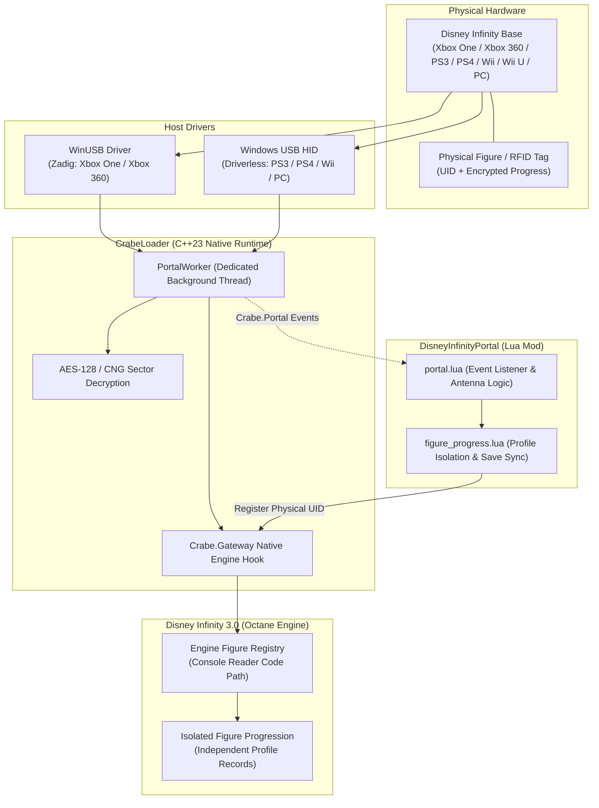

# Disney Infinity Portal

[](https://store.steampowered.com/app/541640/)
[](https://github.com/LucasLhomme/CrabeLoader)
[-purple.svg)](#)
[](https://opensource.org/licenses/MIT)

Physical **Disney Infinity Base (Portal of Power)** support and **Engine Gateway** restoration for **Disney Infinity 3.0: Gold Edition (PC)**.

Bring back the authentic console Toys-to-Life experience on PC: place physical figures on the portal to play them with their **own RFID-bound level, experience, and skill tree**. The game maintains an isolated profile record for each unique physical figure, completely independent from characters unlocked via the PC virtual reader.

---

## Architecture Overview



---

## Hardware Compatibility Matrix

| Base Hardware | USB VID:PID | Model / Controller | Driver | Status |
| :--- | :---: | :---: | :---: | :--- |
| **Xbox One** | `0E6F:0229` | PDP `INF-8037059` | **WinUSB** (via Zadig) | **Fully Verified In-Game** (GIP security handshake, encrypted sector reads, antenna detection) |
| **Xbox 360** | `24C6:FA00` | PDP `INF-8032385` | **WinUSB** (via Zadig) | Implemented via native engine transport (`0B 15` frame envelope) |
| **PS3 / PS4 / Wii / Wii U / PC** | `0E6F:0129` | Standard USB HID | Native Windows HID | Implemented via direct HID transport (Driverless) |
| **Virtual Portal** | N/A | Software Emulation | None | Supported natively through [CrabeMenu](https://github.com/LucasLhomme/CrabeMenu) (`F5`) |

---

## Key Features

- **Live Hot-Plug Detection:** Place a physical figure on **Player 1** or **Player 2** to instantly swap into that character. Lift the figure to smoothly revert to your previous character.
- **One Progression Per Physical Figure (Console Parity):** Each figure enters the game under its unique RFID UID. Progression (level, XP points, and unlocked skill bits) is loaded directly from the figure tag. The game tracks each physical figure's stats separately, even between two identical character figures.
- **Playset Piece Support (Hexagon Slot):** Place a physical playset piece on the hexagonal center antenna (Antenna 2) to register the campaign in the engine registry, exactly as on console.
- **Safe Double-Buffered Tag Writing (Optional):**
  - Turned **off by default** for safety.
  - When enabled, in-game XP and skill gains can be written back to the physical figure.
  - Follows console safety rules: only writes to the older of the figure's two backup copies, never touches identity or ownership blocks, and performs an immediate read-back verification.
- **RGB LED Illumination:** Dynamic slot lighting when figures are placed (Player 1: Cyan, Player 2: Magenta, Hexagon: Gold), complete with interactive LED test modes in CrabeMenu.

---

## Driver Setup (Xbox One & Xbox 360)

The standard Windows Xbox driver (`dc1-controller.sys`) claims the Xbox One base as an internal controller device without exposing it to user-mode applications. **WinUSB** is required.

### Installing WinUSB with Zadig:
1. Plug your Disney Infinity Base into a USB port.
2. Download and launch **[Zadig](https://zadig.akeo.ie/)**.
3. In Zadig, click **Options > List All Devices**.
4. In the dropdown, select **Disney Infinity Base** (Verify `0E6F:0229` for Xbox One or `24C6:FA00` for Xbox 360). *Do not select your gamepad controller!*
5. Select **WinUSB** as the replacement driver and click **Replace Driver**.
6. Unplug the base and plug it back in.

*(PS3, PS4, Wii, Wii U, and PC bases use standard USB HID and require no driver installation).*

---

## Installation & Deployment

### Prerequisites
- **[Disney Infinity 3.0: Gold Edition](https://store.steampowered.com/app/541640/)** (Steam PC)
- **[CrabeLoader v1.1.0+](https://github.com/LucasLhomme/CrabeLoader)** (Provides the native C++ portal gateway and crypto subsystem)
- **[CrabeMenu](https://github.com/LucasLhomme/CrabeMenu)** (Optional, for in-game F5 GUI and status monitoring)

### Automatic Deployment
Clone this repository and run the deployment script:
```powershell
.\deploy.ps1
```
*(The script automatically discovers your Steam library installation. You can also specify `-GamePath "C:\Your\Path"` if needed).*

### Manual Installation
Copy `mod.json`, `portal.lua`, and `figure_progress.lua` to:
```text
<GameDirectory>\mods\disneyinfinityportal\
```

---

## In-Game Controls & CrabeMenu Integration

1. Start the game with your portal plugged in.
2. Place a figure on **Player 1** or **Player 2**. The slot lights up and the character spawns in-game.
3. Open **CrabeMenu** (`F5`) and navigate to the **Disney Infinity Base** section:
   - **Base Status:** View connection health, firmware revision, active slot tags, and detected levels.
   - **Save Progress to Figures:** Toggle live writing back to physical tags (disabled by default).
   - **LED Controls:** Test custom RGB color sweeps across all three antenna pads.
   - **Virtual Figures:** Emulate tag placement for any character directly from the menu.

All portal events and gateway operations are logged in real-time to `<GameDirectory>\loader.log` prefixed with `[DisneyInfinityPortal]`.

---

## Repository Structure

```text
DisneyInfinityPortal/
├── docs/
│   ├── AUDIT.md          # In-depth technical reverse-engineering audit of Disney Gateway protocol & GIP
│   └── STATUS.md         # Hardware validation logs, test benches, and development progress notes
├── deploy.ps1            # Auto-discovery deployment script for Disney Infinity 3.0
├── figure_progress.lua   # Profile isolation, UID registration, and double-buffered RFID tag sync
├── mod.json              # CrabeLoader mod manifest
├── portal.lua            # Entry point: antenna event handler, LED manager, and CrabeMenu UI integration
├── README.md             # Project documentation and setup guide
└── .gitignore            # Workspace ignore rules
```

---

## The DIM2 Modding Ecosystem

DisneyInfinityPortal is part of the **DIM2** open-source modding suite for Disney Infinity 3.0:

| Project | Description | Link |
| :--- | :--- | :---: |
| **CrabeLoader** | Next-generation C++23 modloader, ASI bootstrap, and low-level engine hook framework. | [GitHub](https://github.com/LucasLhomme/CrabeLoader) |
| **CrabeMenu** | Autonomous in-game mod menu (`F5`) with full gamepad and keyboard navigation. | [GitHub](https://github.com/LucasLhomme/CrabeMenu) |
| **DisneyInfinityCreator** | Comprehensive character creation, model extraction, and modding toolkit. | [GitHub](https://github.com/LucasLhomme/DisneyInfinityCreator) |

---

## Technical Documentation & Research

For protocol specifications, cryptographic details (Mifare Ultralight per-figure AES-128 keys, CRC calculation, and sector layouts), and GIP handshake sequences, refer to:
- **[`docs/AUDIT.md`](docs/AUDIT.md)**: Full reverse-engineering audit and protocol dissection.
- **[`docs/STATUS.md`](docs/STATUS.md)**: Hardware test benchmarks and progression tracking status.
- **[CrabeLoader Portal Guide](https://github.com/LucasLhomme/CrabeLoader/blob/dev/docs/guides/portal.md)**: C++ subsystem documentation.

---

## License & Credits

- **Author:** Lucas Lhomme ([@LucasLhomme](https://github.com/LucasLhomme))
- **License:** [MIT License](LICENSE)
- Special thanks to the Disney Infinity reverse-engineering community.
